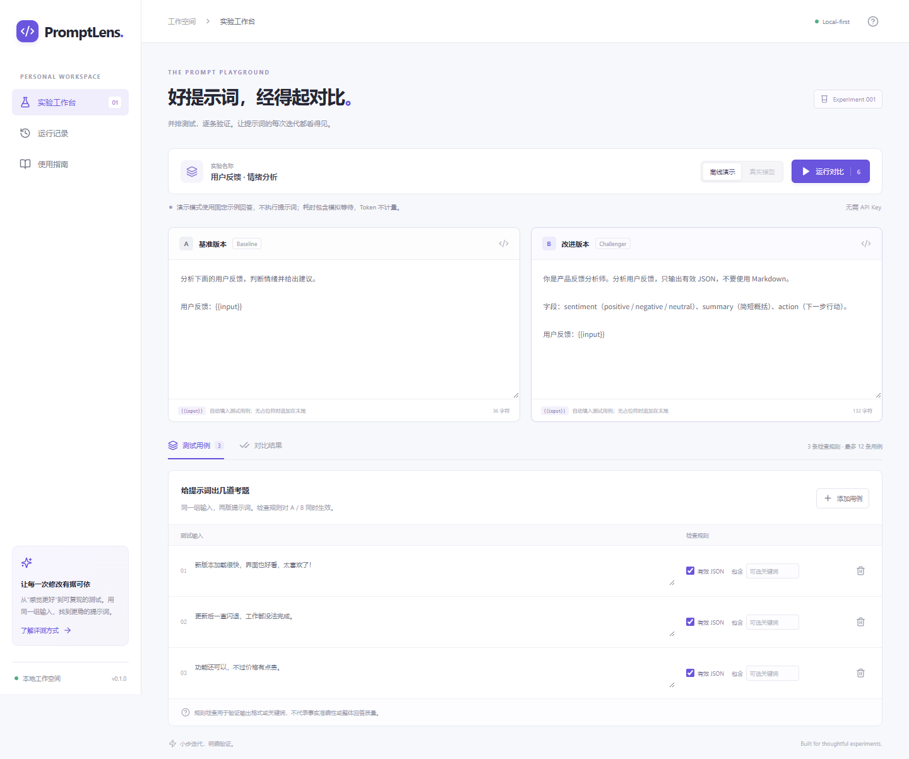
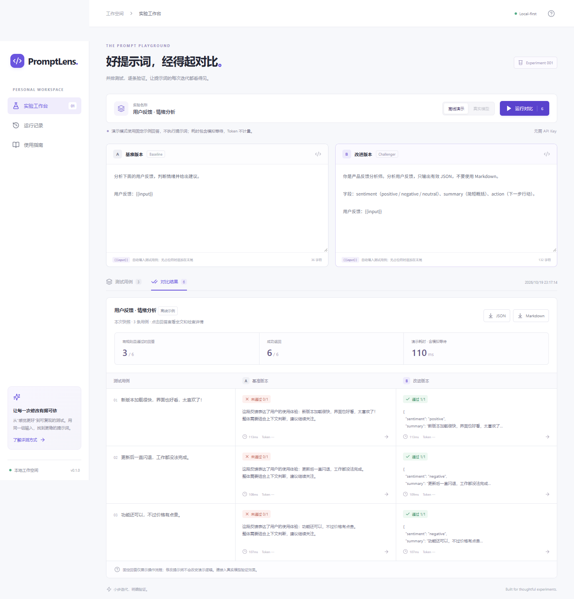

# PromptLens · 提示词实验室

**把两版提示词放到同一组测试里，用原始回答和可复现规则判断改动。**

[English](README.md) · [作品集介绍](docs/PORTFOLIO.md) · [验证记录](docs/VERIFICATION.md)



## 开始使用

安装 Node.js **24.15 或更高版本**，进入项目目录：

```sh
npm ci
npm run dev
```

打开 **http://127.0.0.1:5173**，点击“运行对比”。不需要 API Key 就能体验离线示例。

生产模式：

```sh
npm run build
npm start
```

打开 **http://127.0.0.1:3001**。

## 已实现

- A/B 两版提示词编辑，支持 `{{input}}`，没有占位符时在末尾追加输入。
- 共享 1–12 条测试用例，检查完整 JSON 和不区分大小写的必含关键词。
- 回答矩阵、完整回答弹窗、逐项检查、耗时与服务商返回的 Token 总数。
- SQLite 保存最近 50 次已完成实验；支持重开历史快照。
- JSON / Markdown 完整报告导出。
- 真实模型请求并发数为 2，单次 45 秒超时，逐条错误隔离。
- 中文响应式页面、离线演示、中英文文档、CI、MIT 许可。



## 真实模型

复制 `.env.example` 为 `.env`，填写：

```dotenv
MODEL_BASE_URL=https://你的服务地址/v1
MODEL_API_KEY=你的密钥
MODEL_NAME=你的模型名
```

重启服务后选择“真实模型”。接口需兼容 `POST /chat/completions`，返回 `choices[0].message.content` 文本。当前固定发送 `temperature: 0` 和 `max_tokens: 700`，部分模型需要调整适配。密钥只在服务端读取。

演示模式是固定模板，不执行提示词；修改提示词不会改变演示逻辑。演示耗时包含模拟等待，没有 Token 计量。真实模式会向配置的服务商发送提示词与用例，可能产生费用；没有外部 API Key 时不能验证真实模型效果。

## 结果怎么解读

JSON 检查对完整文本直接执行 `JSON.parse`，因此 Markdown 代码围栏会导致失败。关键词检查采用不区分大小写的连续子串匹配。未设规则的回答不计入规则通过数量。Token 仅使用服务商的 `usage.total_tokens`；没有返回就显示“—”。耗时是服务端请求用时。

**格式或关键词检查通过，不代表事实正确，也不代表模型整体更好。** 演示中 B 的 JSON 通过来自预置示例，不能作为提示词效果证据。

## 数据与边界

数据在 `data/promptlens.sqlite`，完成后保存，超过 50 次会移除最早记录。原始回答和导出报告可能包含敏感信息。编辑中的内容刷新后会丢失，已完成实验可从历史打开。提示词编辑不会更新已有结果，需重新运行。

默认仅监听 `127.0.0.1`，适合个人本地使用。没有登录、多用户隔离、流式输出或运行取消；服务退出后不能恢复进行中的任务。同一时间只允许一次实验。12 条用例全部超时时可能运行约 9 分钟。

## 测试与容器

```sh
npm test
npm run build
docker build -t promptlens .
docker run --rm -p 127.0.0.1:3001:3001 -v promptlens-data:/app/data promptlens
```

Docker 命令已提供，初始开发环境未运行容器验证。完整架构、API 和贡献方法见 [英文说明](README.md)。

MIT 开源。欢迎围绕具体使用场景提 issue 或 PR。
